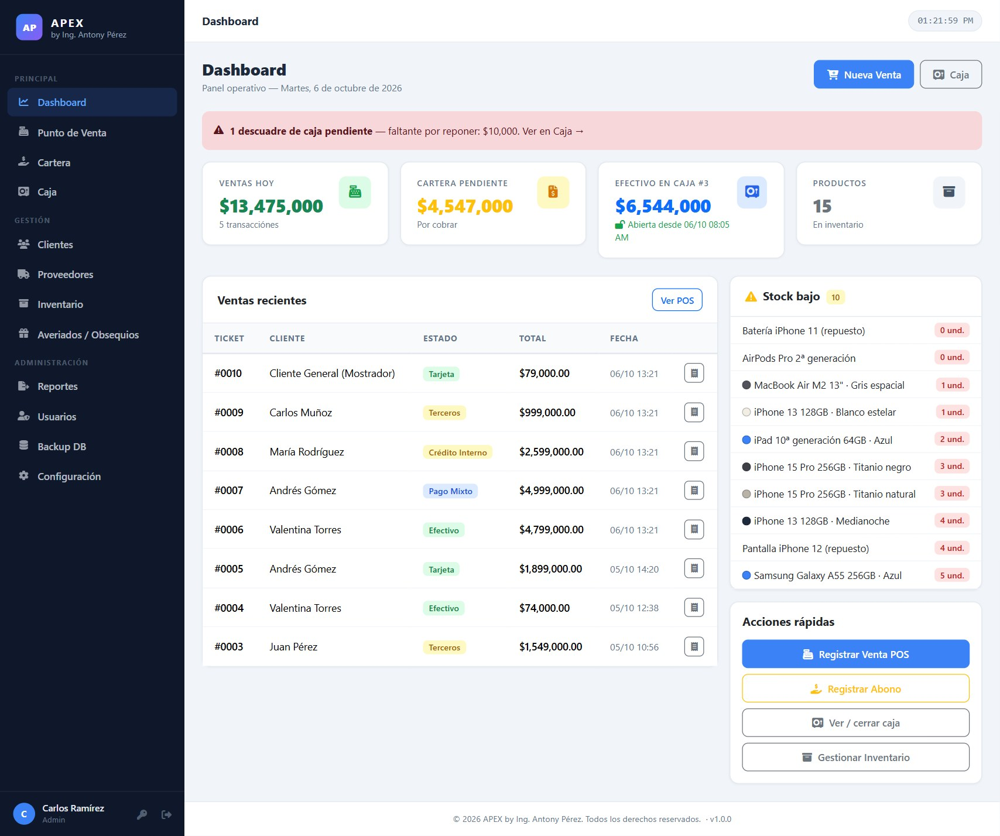
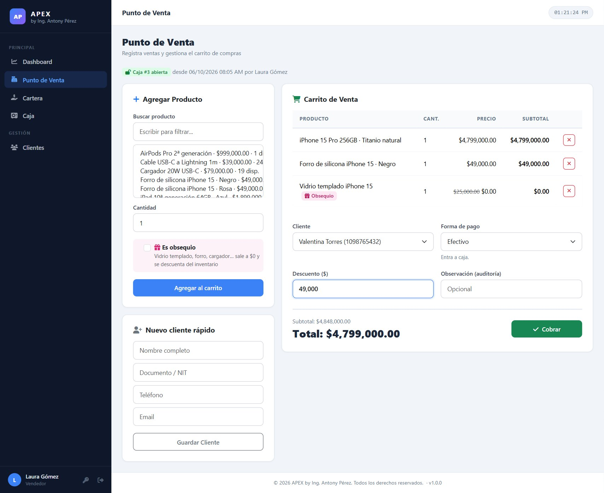
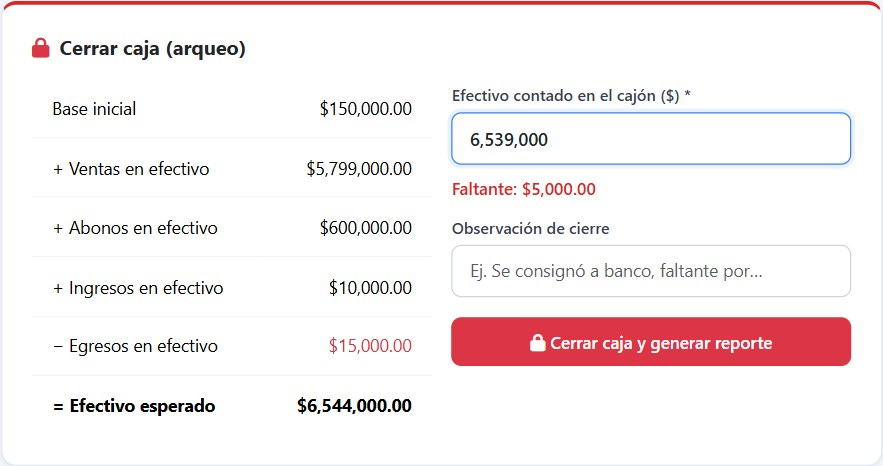
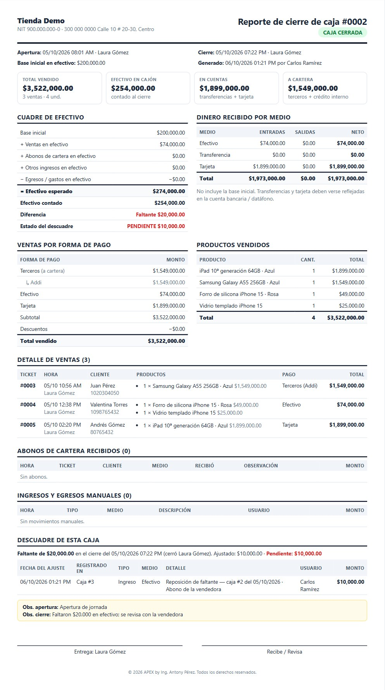
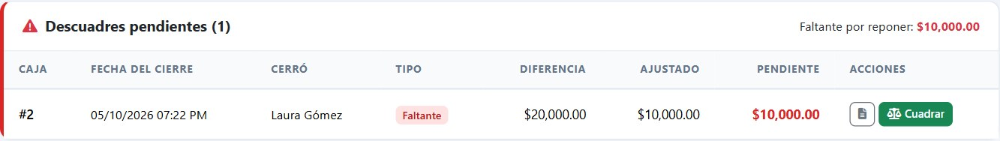

<div align="center">

# APEX

**Sistema Integral de Gestión para tiendas de tecnología**
Punto de venta · Control de caja con arqueo · Cartera · Inventario · Reportes

*by Ing. Antony Pérez*




</div>

---

## Contenido

- [Funcionalidades](#funcionalidades)
- [Capturas](#capturas)
- [Requisitos](#requisitos)
- [Instalación](#instalación)
  - [Windows (XAMPP)](#windows-xampp)
  - [Linux (Ubuntu / Debian)](#linux-ubuntu--debian)
  - [macOS](#macos)
  - [Docker (cualquier sistema)](#docker-cualquier-sistema)
- [Configuración](#configuración)
- [Primer ingreso](#primer-ingreso)
- [Copias de seguridad](#copias-de-seguridad)
- [Actualizar](#actualizar)
- [Seguridad](#seguridad)
- [Pruebas automáticas](#pruebas-automáticas)
- [Estructura del proyecto](#estructura-del-proyecto)
- [Documentación](#documentación)
- [Licencia](#licencia)

## Funcionalidades

| Módulo | Qué hace |
|---|---|
| **Punto de venta** | Carrito con búsqueda, productos por color, obsequios, descuentos y ticket térmico de 80 mm. |
| **Formas de pago** | Efectivo, transferencia, tarjeta, terceros (Addi, Sistecrédito…), crédito interno con autorización y pago mixto. |
| **Caja** | Apertura con base, caja que **nunca se cierra sola**, gastos e ingresos por medio de pago, **arqueo** con sobrante/faltante en vivo y **reporte de cierre en PDF**. |
| **Descuadres** | Cada faltante o sobrante queda **pendiente con su fecha** hasta cuadrarlo con ajustes (totales o parciales). |
| **Cartera** | Cuentas por cobrar, abonos por medio de pago e historial. |
| **Inventario** | Productos con colores y stock, categorías editables, proveedores con lo que suministran, averiados y obsequios. |
| **Reportes** | Excel de ventas, inventario, cartera y descuadres. |
| **Administración** | Usuarios con roles (administrador / vendedor), configuración de la empresa y backup de la base de datos. |

Funciona en computador, tableta y celular.

## Capturas

| Punto de venta | Cierre de caja (arqueo) |
|---|---|
|  |  |
| **Reporte de cierre (PDF)** | **Descuadres pendientes** |
|  |  |

> Las capturas usan datos ficticios de demostración.

## Requisitos

| Componente | Versión |
|---|---|
| PHP | 8.1 o superior, con `pdo_mysql` y `mbstring` |
| Base de datos | MariaDB 10.4+ o MySQL 8 |
| Servidor web | Apache 2.4 con `mod_headers` y `AllowOverride All` (recomendado) o Nginx + PHP-FPM |
| Navegador | Edge, Chrome o Firefox actualizados, con acceso a internet (los estilos y el generador de PDF se cargan desde CDN) |

## Instalación

> **Descarga:** clona el repositorio o descarga el ZIP desde **Code → Download ZIP** (o desde la sección *Releases*).
> La carpeta se puede llamar como quieras; se recomienda `apex`.

### Windows (XAMPP)

1. Instala [XAMPP](https://www.apachefriends.org) con PHP 8.2 y enciende **Apache** y **MySQL** desde el panel de control.
2. Copia el proyecto a `C:\xampp\htdocs\apex`:
   ```powershell
   cd C:\xampp\htdocs
   git clone https://github.com/Aperez27/apex-pos.git apex
   ```
3. *(Recomendado)* Crea la base y un usuario propio con contraseña:
   edita la clave en `deploy\crear_base_mysql.sql` y ejecuta
   ```powershell
   C:\xampp\mysql\bin\mysql.exe -u root < C:\xampp\htdocs\apex\deploy\crear_base_mysql.sql
   ```
   Luego copia `config\config.local.example.php` como `config\config.local.php` y escribe ahí el usuario y la clave.
   *(Si omites este paso, APEX usa `root` sin contraseña, como trae XAMPP.)*
4. Abre **http://localhost/apex/setup.php** para crear las tablas.
5. Entra a **http://localhost/apex** (ver [Primer ingreso](#primer-ingreso)).

### Linux (Ubuntu / Debian)

```bash
# 1. Paquetes
sudo apt update
sudo apt install -y apache2 mariadb-server php php-mysql php-mbstring git
sudo a2enmod headers

# 2. Código
sudo git clone https://github.com/Aperez27/apex-pos.git /var/www/apex

# 3. Base de datos y usuario (cambia la clave dentro del archivo antes de ejecutarlo)
sudo nano /var/www/apex/deploy/crear_base_mysql.sql
sudo mysql < /var/www/apex/deploy/crear_base_mysql.sql

# 4. Configuración local con la misma clave
sudo cp /var/www/apex/config/config.local.example.php /var/www/apex/config/config.local.php
sudo nano /var/www/apex/config/config.local.php

# 5. Permisos: solo la carpeta de registros es escribible por el servidor web
sudo chown -R root:www-data /var/www/apex
sudo chmod -R o-rwx /var/www/apex
sudo chown -R www-data:www-data /var/www/apex/logs

# 6. Sitio de Apache (o usa deploy/nginx-apex.conf si prefieres Nginx)
sudo cp /var/www/apex/deploy/apache-apex.conf /etc/apache2/sites-available/apex.conf
sudo nano /etc/apache2/sites-available/apex.conf        # ServerName
sudo a2ensite apex && sudo systemctl reload apache2

# 7. Tablas
sudo -u www-data php /var/www/apex/setup.php
```

Para HTTPS: `sudo apt install certbot python3-certbot-apache && sudo certbot --apache`.
En Fedora/RHEL los paquetes equivalentes son `httpd mariadb-server php php-mysqlnd php-mbstring` y el usuario del servidor es `apache`.

### macOS

- **Opción recomendada:** [Docker Desktop](#docker-cualquier-sistema).
- **Con XAMPP para macOS:** igual que en Windows, usando `/Applications/XAMPP/xamppfiles/htdocs/apex`
  y `/Applications/XAMPP/xamppfiles/bin/mysql` / `php`.
- **Con Homebrew:** `brew install php mariadb httpd`, habilita `mod_headers` y `AllowOverride All` en `httpd.conf`
  y sigue los pasos 3 a 7 de Linux.

> El servidor integrado de PHP (`php -S`) no aplica las reglas de `.htaccess`: úsalo solo para pruebas locales, nunca en producción.

### Docker (cualquier sistema)

Windows, Linux o macOS con [Docker](https://docs.docker.com/get-docker/):

```bash
git clone https://github.com/Aperez27/apex-pos.git apex && cd apex
cp .env.example .env        # y cambia las contraseñas dentro de .env
docker compose up -d
```

Abre **http://localhost:8080**. El contenedor crea y actualiza la base de datos automáticamente
(MariaDB 10.11 con datos persistentes en el volumen `apex_datos`). Para otro puerto cambia `APEX_PUERTO` en `.env`.

## Configuración

`config/config.php` **no se edita**: los valores de cada instalación van en uno de estos medios (ninguno se sube al repositorio):

| Medio | Uso |
|---|---|
| `config/config.local.php` | Copia de `config.local.example.php`. Ideal para XAMPP y servidores Linux. |
| Variables de entorno | `APEX_DB_HOST`, `APEX_DB_PORT`, `APEX_DB_USER`, `APEX_DB_PASS`, `APEX_DB_NAME`, `APEX_DEBUG`. Ideal para Docker. |

Valores por defecto: `localhost:3306`, usuario `root` sin contraseña, base `apex_db`, sin depuración.
Otras opciones: `SESION_INACTIVIDAD_MIN` (480) y `PASSWORD_MIN` (8). Hora: America/Bogota.

## Primer ingreso

| Usuario | Contraseña inicial | Rol |
|---|---|---|
| `admin` | `admin123` | Administrador |
| `vendedor` | `vendedor123` | Vendedor |

En el primer ingreso **el sistema obliga a cambiar la contraseña inicial**. Después:
**Configuración** (datos de la empresa) → **Usuarios** (uno por vendedor) → **Inventario** (categorías, proveedores, productos) → **Caja** (abrir la primera caja).

## Copias de seguridad

- Desde el sistema: menú **Backup DB → Descargar Backup SQL**.
- Automática en Linux (cron diario a las 22:00):
  ```bash
  0 22 * * * mysqldump -u apex -p'TU_CLAVE' apex_db > /var/backups/apex_$(date +\%F).sql
  ```
- En Windows: tarea programada con `mysqldump.exe` (ver *Manual de Instalación*, capítulo de copias).
- En Docker: `docker compose exec db mariadb-dump -u apex -p apex_db > respaldo.sql`.

Restaurar: `mysql -u apex -p apex_db < respaldo.sql` y luego `php setup.php`.

## Actualizar

```bash
# 1. Respaldo de la base de datos (ver arriba)
git pull                  # o reemplaza los archivos conservando config/config.local.php
php setup.php             # aplica cambios de estructura; es seguro ejecutarlo varias veces
```
Con Docker: `git pull && docker compose up -d --build`.

## Seguridad

- Contraseñas con bcrypt, mínimo 8 caracteres, **cambio obligatorio de la contraseña inicial**.
- Bloqueo de 15 minutos tras 5 intentos fallidos; respuesta idéntica exista o no el usuario.
- Sesiones con cookie `HttpOnly`/`SameSite`/`Secure` (en HTTPS), renovación al ingresar y cierre por inactividad.
- Token CSRF en todos los formularios; consultas SQL parametrizadas; salida escapada contra XSS.
- Cabeceras CSP, anti-clickjacking y `nosniff`; carpetas internas, `.git` y archivos de configuración bloqueados.
- Operaciones de caja, stock y abonos seguras ante usuarios simultáneos (bloqueos transaccionales).
- Errores ocultos al usuario y registrados en `logs/php_errors.log`; instalador bloqueado después de instalar.

Reporte de vulnerabilidades: ver [SECURITY.md](.github/SECURITY.md).

## Pruebas automáticas

```bash
bash tests/e2e.sh            # ≈140 pruebas HTTP: ventas, caja, descuadres, permisos, seguridad
python tests/ui_test.py      # ≈47 pruebas en navegador real (Playwright): pantallas, PDF, celular, XSS
```

Usan un administrador temporal y datos con prefijo `ZZ` que se eliminan al final; no cierran una caja real abierta.
Variables opcionales: `APEX_URL`, `MYSQL_BIN`, `PHP_BIN`, `MYSQL_USER`, `MYSQL_PASS`, `APEX_BROWSER`
(en Linux: `pip install playwright && playwright install chromium`).
En cada *push* se ejecuta la integración continua de GitHub Actions (sintaxis en PHP 8.1–8.3 e instalación sobre MariaDB).

## Estructura del proyecto

```
apex/
├── *.php                    Módulos (ventas, caja, cartera, inventario, reportes…)
├── setup.php                Instalador y actualizador de la base de datos (idempotente)
├── config/                  config.php (no editar) · config.local.example.php · conexion.php
├── includes/                Encabezado, pie, lógica de caja, generador de Excel
├── logs/                    Registro de errores (no se publica)
├── docs/                    Manuales en PDF · fuente/ (HTML y scripts para regenerarlos)
├── tests/                   Pruebas HTTP (bash) y de navegador (Python + Playwright)
├── deploy/                  Ejemplos de Apache, Nginx y creación de la base de datos
├── docker/ · Dockerfile · docker-compose.yml
└── .htaccess                Reglas de seguridad de Apache
```

## Documentación

| Manual | Para |
|---|---|
| [Manual de Usuario](docs/01_Manual_de_Usuario.pdf) | Vendedores y administradores |
| [Manual de Instalación](docs/02_Manual_de_Instalacion.pdf) | Instalación, copias de seguridad y producción |
| [Manual Técnico](docs/03_Manual_Tecnico.pdf) | Arquitectura, base de datos, seguridad y mantenimiento |
| [Guía Rápida](docs/04_Guia_Rapida.pdf) | Tareas del día a día (2 páginas, para imprimir) |

Historial de cambios: [CHANGELOG.md](CHANGELOG.md).

## Licencia

**Software propietario.** © 2026 Ing. Antony Pérez. Todos los derechos reservados.
El código es visible con fines de consulta; su uso, copia, modificación o distribución requiere autorización
escrita del autor. Ver [LICENSE](LICENSE). Para licencias de uso: [@Aperez27](https://github.com/Aperez27).
